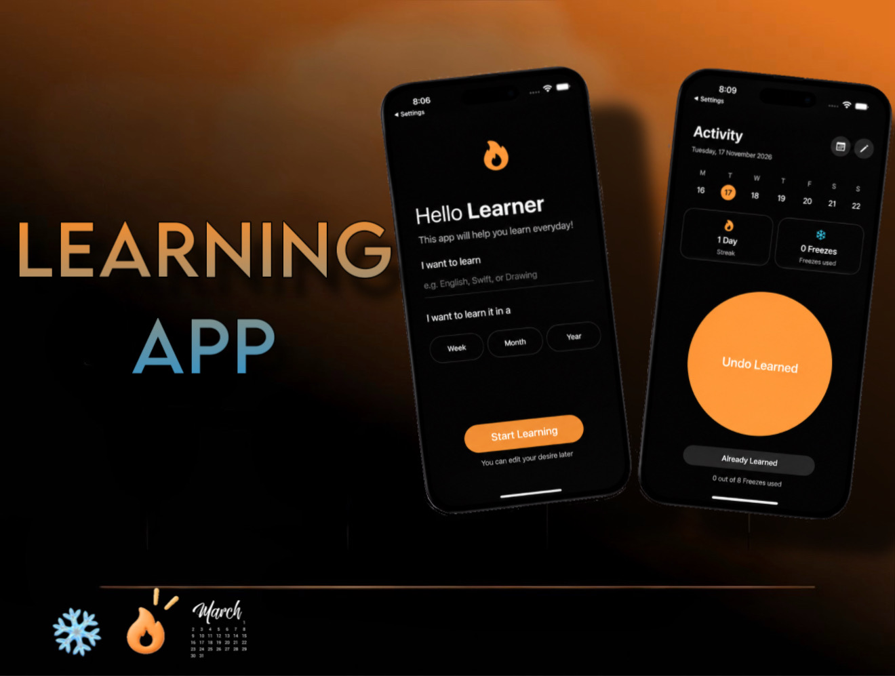

<h1 align="center"><strong>Learning 📚📖</strong></h1>

  

---

<h2>About the App 📖</h2>

Learning is an iOS app designed to help users build consistent learning habits. It allows users to set personal learning goals, track their daily progress, and maintain their learning streaks.

---

<h2>Purpose🎯</h2>

The purpose of Learning is to encourage consistent learning habits by helping users set goals, monitor their progress, and stay motivated through daily streaks.
---

<h2>Features✨</h2>

- **Personal Learning Goals:** Set a learning goal based on your interests.
- **Flexible Duration:** Choose your preferred learning duration.
- **Daily Progress Tracking:** Track your daily learning activity.
- **Activity Calendar:** View your learning history and daily progress.
- **Learning Streaks:** Track consecutive learning days and stay motivated.
- **Freeze System:** Protect your learning streak when you need a break.

---

<h2>Getting Started🚀</h2>

1. Clone the repository.
2. Open the project in Xcode.
3. Build and run the app on the simulator or a connected iPhone.

---

<h2>Technologies Used 🛠</h2>

- Swift
- SwiftUI
- MVVM Architecture
- Xcode

---
<h2>Contact 📮📩</h2>
---

  Developed by Linah ✨
   
  <a href="https://github.com/Lsa-23">GitHub</a> |
  <a href="https://www.linkedin.com/in/linah-salem-630abb310/">LinkedIn</a>

